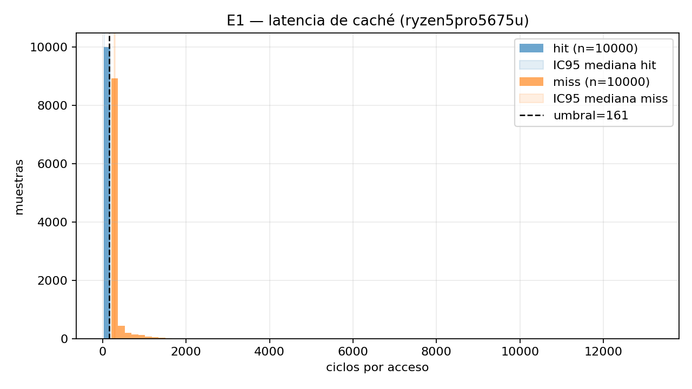
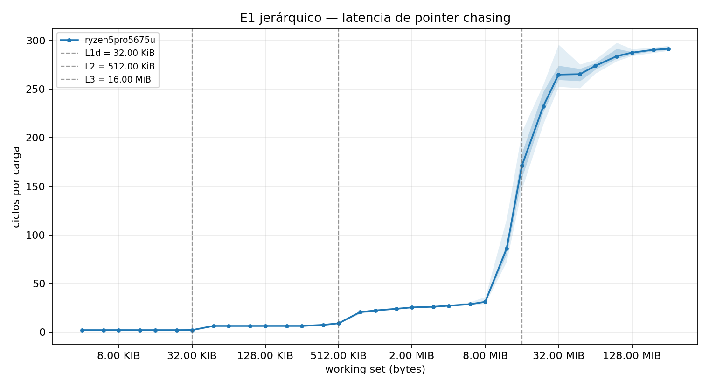
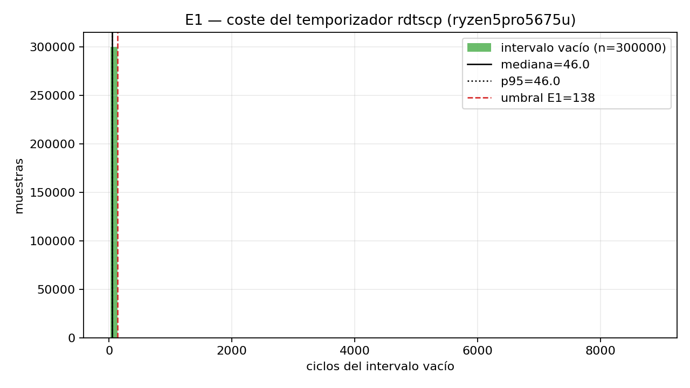
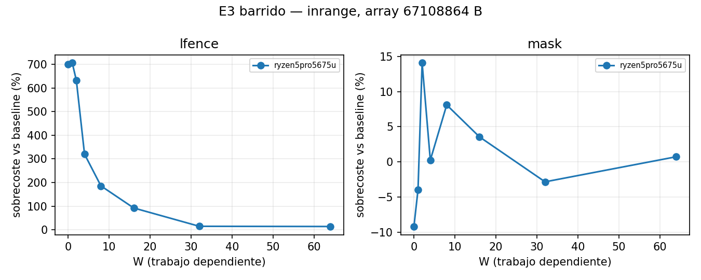
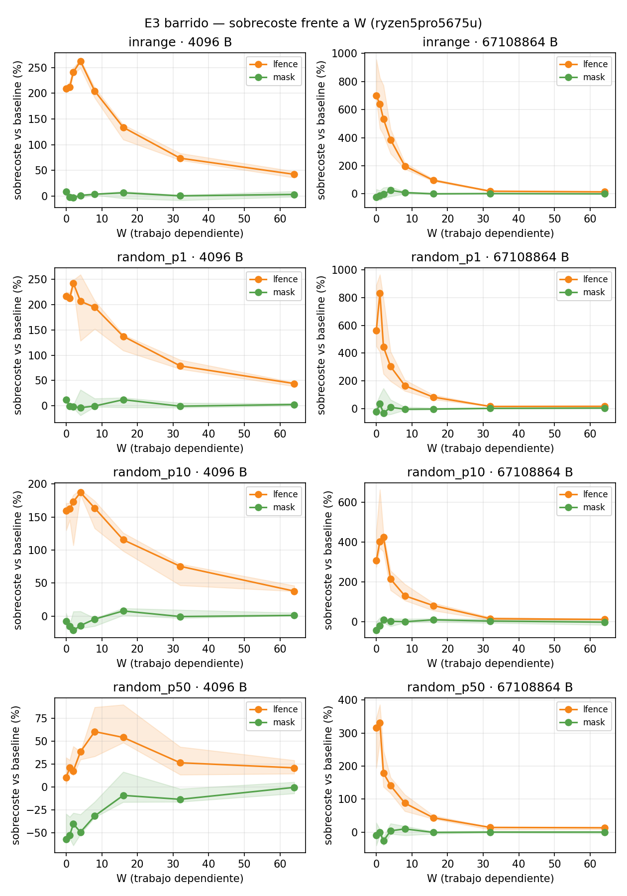
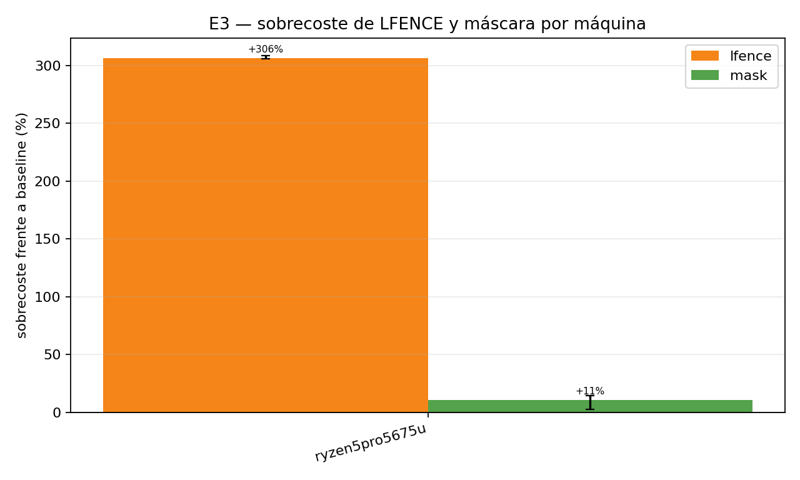
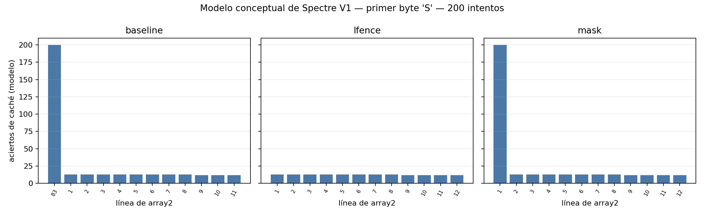

# Spectre V1: ejecución especulativa, predicción de saltos y canales laterales en caché

**Trabajo de Arquitectura Avanzada**  
**Informe final** · 25 de noviembre de 2026

| | |
|---|---|
| **Ámbito** | Spectre V1 en un único proceso; `LFENCE` y enmascarado de índices |
| **Evidencia empírica** | AMD Ryzen 5 PRO 5675U (Zen 3, Cezanne), cuatro sesiones |
| **Evidencia conceptual** | Modelo de predictor de 2 bits y Flush+Reload simulado |
| **Estado de la campaña** | 1 de 2–3 microarquitecturas; el resto queda como `PENDIENTE` |

> **Nota de alcance.** Este informe no afirma que un procesador sea o no
> vulnerable, ni que una mitigación sea gratuita o infalible. Los resultados
> describen lo observado en las condiciones medidas. Las celdas `PENDIENTE`
> corresponden a microarquitecturas que aún no se han medido y no se rellenan
> con datos estimados.

---

## Resumen

Este trabajo estudia cómo la predicción de saltos y la ejecución especulativa
pueden producir una fuga de información observable a través de la caché, y cuál
es el coste de dos mitigaciones de Spectre V1: `LFENCE` y el enmascarado de
índices. La experimentación empírica se centra en la caracterización de la caché
(E1) y en el sobrecoste de las mitigaciones (E3). El mecanismo de explotación
(E2) se aborda desde el análisis documental y un modelo conceptual; la prueba de
concepto en hardware se conserva como anexo ilustrativo, no como resultado.

Se midieron cuatro sesiones en arranques distintos del mismo equipo, un Ryzen 5
PRO 5675U. Tres de ellas se ejecutaron a ~4,2–4,3 GHz y una a ~2,47 GHz. En E1,
los modos `hit` y `miss` aparecen claramente separados, pero el umbral cambió
entre arranques (184, 138, 161 y 138 ciclos): es un parámetro por sesión y por
máquina. La meseta de L1d se mantuvo en 2,13–3,56 ciclos por carga y la de L2 en
6,43–10,21. La meseta de L3 fue de 29,3–30,3 ciclos en las tres sesiones a
~4,2–4,3 GHz, pero de 298,3 en la sesión de 2,47 GHz. Esa diferencia se explica
en parte por la frecuencia y se documenta como una limitación del montaje: las
sesiones con frecuencias que difieren más de un 10 % no se agregan. El coste del
temporizador vacío coincidió con la mediana de `hit` (69 y 46 ciclos), lo que
muestra que una medida de un solo acceso está dominada por el propio montaje.

En E3 se barrieron 128 combinaciones de trabajo dependiente, predictibilidad y
tamaño de array en las dos sesiones de 15 bloques. `LFENCE` fue siempre más
lenta: sobrecoste mediano del +138,2 %, con un rango de +5,6 % a +488,7 % y un
factor de lentitud mediano de 2,4×. La máscara, en cambio, tuvo un coste pequeño
y positivo: mediana +3,5 %, rango −2,2 % a +22,6 %. En 19 de las 64
combinaciones el intervalo del 95 % cruza cero, así que en algunas condiciones
no se distingue de cero; no aparece la gran ganancia que sugerían los datos
antiguos, obtenidos con una implementación de la máscara que el compilador
reducía a un acceso sin máscara en la ruta transitoria. El modelo conceptual
reprodujo la lógica del mecanismo (40/40 bytes en `baseline`, 0/40 en `lfence` y
`mask`), siempre como resultado del modelo, no como medida de hardware.

La conclusión principal es que, en estas condiciones, `LFENCE` tiene un coste
alto y de signo estable, mientras que el enmascarado tiene un coste pequeño que
puede quedar dentro del ruido. La comparación entre microarquitecturas queda
pendiente y es la principal línea de trabajo futuro.

---

## 1. Introducción y motivación

### 1.1 El problema

Los procesadores modernos mantienen el pipeline lleno prediciendo el resultado
de los saltos y ejecutando instrucciones antes de conocerlo. Cuando la
predicción falla, el estado arquitectónico se restaura, pero el estado
microarquitectónico no: las líneas de caché cargadas durante la ejecución
transitoria permanecen. Spectre V1 convierte esa asimetría en un canal lateral:
una comprobación de límites mal predicha permite un acceso fuera de rango, y el
rastro que deja en caché revela información que el programa nunca debió exponer.

El interés del trabajo es doble. Por un lado, el mecanismo: entender por qué una
optimización legítima rompe la separación entre estado arquitectónico y
observable. Por otro, el coste: una mitigación solo es adoptable si su precio es
conocido, y ese precio depende del código, del compilador y de la
microarquitectura. Un mismo `LFENCE` puede ser barato en un bucle con mucho
trabajo útil y muy caro cuando el acceso falla en caché.

### 1.2 Pregunta de investigación y objetivos

**Pregunta.** ¿Cómo provocan la predicción de saltos y la ejecución especulativa
una filtración observable a través de la caché, y qué sobrecoste tienen
`LFENCE` y el enmascarado de índices en distintas microarquitecturas?

**Objetivos específicos.**

1. Describir los mecanismos de pipeline, predicción, especulación y caché que
   intervienen en Spectre V1.
2. Explicar el mecanismo de explotación con análisis documental, ensamblador y
   un modelo conceptual reproducible.
3. Caracterizar experimentalmente la caché: latencia de acierto y fallo,
   mesetas de la jerarquía y coste del temporizador (E1).
4. Medir el sobrecoste de `LFENCE` y del enmascarado en un barrido de
   sensibilidad (E3).
5. Discutir qué se puede y qué no se puede concluir con una sola
   microarquitectura.

**Hipótesis de coste.** `LFENCE` tendrá más sobrecoste que el enmascarado, y la
diferencia dependerá de la microarquitectura y del contexto de ejecución. La
hipótesis se contrasta en E3, no con una tasa de recuperación.

### 1.3 Contribución y estructura

La contribución experimental es un *harness* reproducible que separa tres tipos
de evidencia: empírica (E1 y E3), conceptual (modelo de E2) y documental
(literatura y ensamblador). El informe sigue ese orden: fundamentos (§2),
mecanismo (§3), metodología (§4), resultados E1 (§5), resultados E3 (§6),
mecanismo E2 (§7), discusión (§8), limitaciones (§9) y conclusiones (§10).

---

## 2. Fundamentos

### 2.1 Pipeline, ejecución fuera de orden y ventana de ejecución

Un procesador segmenta la ejecución en etapas (búsqueda, decodificación,
renombrado, emisión, ejecución, retirada). Para no detener el pipeline cuando
una instrucción espera un dato, el hardware mantiene una ventana de
instrucciones en vuelo y las ejecuta fuera de orden, siempre que no haya
dependencias que lo impidan. Los resultados se guardan en un *reorder buffer* y
se confirman en orden en la retirada.

Esa ventana es la que hace posible la ejecución transitoria: una instrucción
puede ejecutarse y producir efectos microarquitectónicos antes de que se sepa si
debía ejecutarse. La retirada es el punto en el que el estado arquitectónico se
compromete; lo que ocurre antes puede dejar huella sin ser visible en registros
o memoria.

### 2.2 Predicción de saltos y recuperación

Ante un salto condicional, el procesador predice si se tomará y cuál será el
destino, y continúa ejecutando por esa ruta. Los predictores modernos combinan
historia global, historia local y correlación entre saltos; un patrón repetido
—por ejemplo, una comprobación de límites que casi siempre es verdadera— se
aprende con rapidez.

Cuando la predicción se resuelve, hay dos casos:

- **Acierto:** la ejecución continúa sin penalización.
- **Fallo:** las instrucciones ejecutadas por la ruta incorrecta se descartan y
  el *front-end* se redirige. El coste visible es la penalización de
  malpredicción; el coste invisible puede ser el estado que dejaron esas
  instrucciones.

Spectre V1 explota precisamente el segundo caso: el atacante entrena el
predictor para que la comprobación se prediga como verdadera y después presenta
un índice fuera de rango. La comprobación se resuelve como falsa, pero el cuerpo
ya se ejecutó transitoriamente.

### 2.3 Jerarquía de caché y medida del tiempo

La jerarquía de caché se organiza en niveles con capacidad y latencia crecientes:
L1 de datos (por núcleo, decenas de KiB), L2 (por núcleo, cientos de KiB), L3
(compartida, varios MiB) y memoria principal. Cada nivel se divide en líneas
(típicamente 64 B), y un acceso que falla en un nivel busca en el siguiente.

La latencia se mide con `rdtscp`, que lee el contador de marca de tiempo, y
`clflush`, que expulsa una línea. La secuencia habitual es
`lfence; rdtscp; acceso; lfence; rdtscp`, y la diferencia entre las dos lecturas
es el tiempo del acceso más el coste del propio montaje. Ese coste no es
despreciable: en este equipo, el intervalo vacío tiene una mediana de 46–69
ciclos, del mismo orden que un acierto en L1. Por eso el coste del temporizador
se publica aparte y **no se resta** silenciosamente de las latencias (§5.3).

### 2.4 Estado arquitectónico frente a estado microarquitectónico

El estado arquitectónico es el que define el programa: registros, memoria,
banderas. El estado microarquitectónico incluye cachés, buffers, predictores y
colas. La arquitectura x86-64 garantiza que una ejecución transitoria no escriba
memoria ni registros de forma visible, pero no garantiza que no modifique el
estado microarquitectónico.

Spectre V1 vive en esa grieta. El valor cargado transitoriamente no se confirma,
pero la línea de `array2` que se tocó con él sí queda en caché. Un observador que
pueda medir tiempos puede inferir qué línea se cargó y, con ella, el byte
secreto. La mitigación debe cortar el acceso transitorio (barrera) o hacer que el
índice no dependa del valor secreto (enmascarado).

---

## 3. Spectre V1: mecanismo

### 3.1 Modelo de amenaza

El escenario es de **un solo proceso**: atacante y víctima comparten espacio de
direcciones, el atacante puede ejecutar código y medir tiempos, y el secreto es
sintético y conocido por el diseño del experimento. No se cubren ataques entre
procesos, contra el kernel, sandboxes ni otras variantes de Spectre. El objetivo
es estudiar el mecanismo y su coste, no demostrar un robo de datos real.

### 3.2 Ejemplo mínimo en C

El patrón vulnerable es una comprobación de límites seguida de un acceso
dependiente del valor:

```c
if (x < array1_size)
    temp &= array2[array1[x] * 512];
```

Con `x` fuera de rango:

1. El predictor ha aprendido, por entrenamiento, que la condición es verdadera.
2. La comprobación se predice como tomada y el cuerpo entra en ejecución.
3. `array1[x]` lee un byte fuera del array; `array2[byte * 512]` toca una línea
   distinta por cada valor posible.
4. La comprobación se resuelve como falsa y el estado arquitectónico se
   descarta.
5. La línea de `array2` correspondiente al byte secreto queda en caché.

El multiplicador 512 separa las líneas de `array2`: 256 valores posibles × 512 B
= 128 KiB, de modo que cada candidato cae en una línea distinta y el canal tiene
resolución de un byte.

### 3.3 Secuencia en ensamblador

El binario se compila con `-O2 -fno-if-conversion -fno-if-conversion2` y la
función vulnerable se marca `noinline`. El desensamblado confirma que las tres
variantes conservan la forma prevista (Anexo B):

- **`baseline`:** `cmp` + salto condicional `jbe`. El acceso queda dentro del
  cuerpo del salto y puede ejecutarse transitoriamente.
- **`lfence`:** `cmp` + `jbe` + `lfence` antes del acceso. La barrera impide que
  el acceso se ejecute antes de resolver la comprobación.
- **`mask`:** `cmp` + `seta` + `neg` + `and`, sin salto condicional. El índice se
  anula si `x` está fuera de rango y el acceso se ejecuta siempre, pero a la
  línea 0.

La diferencia entre `baseline` y `mask` no es solo de instrucciones: es un cambio
de dependencia. En `mask`, la dirección depende del resultado de la comparación
a través de una cadena de datos, no de una predicción de control.

### 3.4 Línea temporal del ataque

| Paso | Acción | Estado relevante |
|---|---|---|
| 1 | Entrenar el predictor con índices válidos | Predictor saturado en “tomado” |
| 2 | Expulsar `array1_size` y las líneas de `array2` | Caché fría para el canal |
| 3 | Ejecutar `victim_function(x)` con `x` fuera de rango | Predicción errónea |
| 4 | El cuerpo accede a `array1[x]` y a `array2[byte*512]` | Línea cargada en caché |
| 5 | La comprobación se resuelve y se descarta el estado | Arquitectura restaurada |
| 6 | Medir las 256 líneas de `array2` | Canal Flush+Reload |
| 7 | Elegir la línea más rápida | Byte inferido |

### 3.5 Flush+Reload

Flush+Reload explota la diferencia de latencia entre un acceso que acierta en
caché y uno que falla. El atacante expulsa las líneas candidatas, provoca la
ejecución transitoria y mide cada línea. La línea que la víctima cargó responde
más rápido. La calidad del canal depende de que la línea siga en caché durante la
medida y de que el ruido no la expulse; por eso el protocolo fija la CPU, mide
muchas muestras y usa medianas, no medias.

### 3.6 Mitigaciones estudiadas

**`LFENCE`.** Es una barrera de serialización de carga. Colocada después de la
comprobación y antes del acceso, impide que el acceso se ejecute hasta que la
comprobación se haya resuelto. Su eficacia es conceptualmente sólida, pero su
coste puede ser alto porque corta el solapamiento entre la carga y el trabajo
posterior. En AMD, el comportamiento serializante de `LFENCE` depende de la
configuración del sistema: el kernel puede activar un bit del MSR
`MSR_AMD64_DE_CFG` (0xC0011029) cuando aplica la mitigación. En este trabajo no
se leyó ese MSR, así que el coste observado se atribuye al montaje medido, no a
un valor concreto del registro.

**Enmascarado de índices.** Se calcula una máscara dependiente de la comparación
y se aplica al índice:

```c
size_t mask = (size_t)0 - (size_t)(x < array1_size);
size_t idx  = x & mask;
temp &= array2[array1[idx] * 512];
```

Si `x` está fuera de rango, `mask = 0` e `idx = 0`; si está dentro, `mask` es
todo unos e `idx = x`. No hay salto condicional y la dirección depende de una
cadena de datos, de modo que el acceso transitorio no puede usar el índice
fuera de rango. El precio es una cadena de operaciones en el camino crítico de
la dirección.

---

## 4. Metodología

### 4.1 Diseño experimental

| Experimento | Tipo | Qué mide | Estado |
|---|---|---|---|
| E1 calibración | Empírico | Latencia `hit`/`miss` y umbral | Hecho en Ryzen; faltan CPUs |
| E1 jerárquico | Empírico | Mesetas L1d/L2/L3/memoria | Hecho en Ryzen; faltan CPUs |
| E1 temporizador | Empírico | Coste de `rdtscp` y barreras | Hecho en Ryzen |
| E3 barrido | Empírico | Sobrecoste de `LFENCE` y máscara | Hecho en Ryzen; faltan CPUs |
| E2 documental | Documental | Mecanismo y mitigaciones | Hecho |
| E2 modelo | Conceptual | Lógica de la fuga | Hecho |
| E2 hardware | Anexo ilustrativo | Coincidencia cualitativa | Fuera de resultados |

La distinción importa: E1 y E3 son medidas con CSV y repeticiones; E2 es un
modelo explícito y literatura. Una afirmación del modelo no es una afirmación
sobre una CPU, y un `0/N` en una CPU no es una prueba de imposibilidad.

### 4.2 Equipo

| Campo | Valor |
|---|---|
| `machine_id` | `ryzen5pro5675u` |
| CPU | AMD Ryzen 5 PRO 5675U with Radeon Graphics |
| Familia / modelo / stepping | 25 (0x19) / 80 / 0 |
| Microarquitectura | Zen 3 (Cezanne) |
| Microcódigo | `0xa500014` |
| Cachés | L1d 192 KiB total (32 KiB por núcleo), L2 3 MiB (512 KiB por núcleo), L3 16 MiB |
| Kernel | 6.8.0-149-generic |
| Compilador | GCC 11.4.0 |
| Virtualización | Nativo |
| `spectre_v1` | *usercopy/swapgs barriers + `__user` pointer sanitization* |
| Sesiones | `20261124-200944`, `20261125-084943`, `20261125-141147` (A), `20261125-143804` (B) |

El equipo es nativo y las cuatro sesiones se hicieron en arranques distintos. La
ficha completa está en `data/ryzen5pro5675u/env_ryzen5pro5675u.txt` y en
[`docs/machines.md`](../docs/machines.md). La primera sesión se ejecutó a
2.470,3 MHz; las otras tres, a 4.291,8, 4.292,0 y 4.225,9 MHz. Por esa diferencia
de frecuencia no se agregan sus latencias en ciclos.

### 4.3 Protocolo de E1

- **Calibración:** 10.000 muestras por modo (`hit` y `miss`), buffer de 64 MiB,
  `clflush` + `rdtscp`. Umbral elegido en el valle del histograma **por sesión**.
- **Jerárquico:** *pointer chasing* con permutación Sattolo, nodos de 64 B,
  barrido de 4 KiB a 256 MiB en puntos `2^k` y `1,5·2^k`. Treinta repeticiones
  por tamaño (990 filas por sesión). Las mesetas se calculan
  en la ventana central [25 %, 75 %] de la capacidad de cada nivel; para memoria,
  tamaños ≥ 2·L3.
- **Temporizador:** 300.000 intervalos vacíos
  `lfence; rdtscp; lfence; rdtscp` en tres repeticiones, sin carga dependiente.
- El proceso se fija a la segunda CPU permitida con `taskset`; la columna
  `pinned_cpu` registra la CPU real. `hugepage = none` en las cuatro sesiones.

### 4.4 Protocolo de E3

El barrido mide el coste del chequeo de límites en función de tres factores:

- **`W` (trabajo por iteración):** 0, 1, 2, 4, 8, 16, 32, 64 operaciones
  dependientes del byte cargado. `W = 0` consume el valor en un sumidero
  `volatile`; `W > 0` aplica una cadena de multiplicaciones y sumas.
- **Predictibilidad:** `inrange` (todos los índices dentro del array) y
  `random_p1`, `random_p10`, `random_p50` (porcentaje de índices fuera de rango
  generado al azar).
- **Array:** 4 KiB (cabe en L1) y 64 MiB (mayor que L3).

Cada combinación se mide con 200.000 iteraciones, 15 bloques y 3 repeticiones
por bloque, con calentamiento previo de 256 iteraciones. Son 64 combinaciones
por sesión. Los índices se generan antes de medir con `splitmix64` y semilla
fija; las tres variantes de una combinación usan los mismos índices, de modo que
la comparación es emparejada. Las variantes se intercalan por bloques en orden
aleatorio derivado de la semilla.

El resultado principal de E3 usa las sesiones A y B, las dos con 15 bloques y
la máscara aritmética nueva. Las sesiones `20261124-200944` y
`20261125-084943` usaron cinco bloques y una máscara que el compilador reducía
a un acceso sin `and`; se conservan como control histórico de `LFENCE`, pero su
variante `mask` no se mezcla en las tablas principales.

### 4.5 Protocolo de E2

- **Documental:** lectura del paper de Kocher et al., la propuesta P0928R1, el
  análisis de Kocher sobre el compilador de Microsoft y el artículo de USENIX
  Security 2025.
- **Modelo:** `analysis/simulate_spectre.py` simula un predictor de 2 bits, la
  ejecución transitoria, el acceso a `array2`, el rastro en caché y
  Flush+Reload. Se ejecuta con 200 intentos, 5 aciertos de entrenamiento y un
  secreto de 40 bytes.
- **Hardware:** la PoC se conserva como anexo ilustrativo y no produce cifras en
  el cuerpo principal.

### 4.6 Estadística

- **Dispersión:** mediana, p5, p95 e IQR. La media y la desviación típica no son
  la métrica principal porque las latencias tienen colas largas.
- **Precisión de la mediana:** bootstrap de 10.000 remuestreos, percentiles 2,5
  y 97,5.
- **E3:** bootstrap por bloques emparejados. Se resume cada bloque con la
  mediana de sus repeticiones y se remuestrean bloques completos, no filas
  sueltas; el intervalo se calcula sobre el cociente variante/base.
- **Proporciones:** intervalo de Wilson. Un `0/N` se reporta como cota superior
  aproximada `3/N`, no como cero garantizado.
- Los intervalos cuantifican la precisión en las condiciones medidas; no corrigen
  el sesgo del montaje.

### 4.7 Reproducibilidad y controles

- Código, scripts, flags, versión de GCC, kernel, microcódigo y estado de
  `spectre_v1` quedan registrados en `env_<machine_id>.txt`.
- `make`, `make smoke`, `make test`, `make asm`, `make figures` y `make validate`
  forman parte del flujo de verificación.
- Los CSV crudos se conservan en `data/<machine_id>/<session_id>/`. Las figuras y
  tablas se generan desde los CSV; no se teclean a mano.
- El ensamblador se revisa con `objdump`: `baseline` debe conservar un salto
  condicional y ningún `cmov`; `lfence` debe contener `lfence`; `mask` debe
  contener el salto condicional, `sbb` y `and`, sin `lfence` ni `cmov`.
- No se mezclan `-O0` con `-O2` en las figuras principales, ni la campaña
  *legacy* con el barrido nuevo.

### 4.8 Validez

La validez interna depende de que el montaje mida lo que dice medir: la
verificación del ensamblador y la separación de modos en E1 son los dos controles
principales. La validez externa es limitada por el escenario de laboratorio
(mismo proceso, secreto sintético, una sola microarquitectura) y se discute en
§9. Las conclusiones se formulan como “en estas condiciones”.

---

## 5. Resultados E1: caracterización de la caché

### 5.1 Calibración `hit`/`miss`

| Sesión | `hit` mediana | `hit` p5 / p95 | `miss` mediana | `miss` p5 / p95 | n por modo | Umbral |
|---|---:|---:|---:|---:|---:|---:|
| `20261124-200944` | 69 | 69 / 92 | 322 | 276 / 874 | 10.000 | **184** |
| `20261125-084943` | 46 | 23 / 46 | 276 | 230 / 621 | 10.000 | **138** |
| `20261125-141147` (A) | 46 | 46 / 69 | 299 | 253 / 644 | 10.000 | **161** |
| `20261125-143804` (B) | 46 | 23 / 46 | 276 | 230 / 575 | 10.000 | **138** |

Los dos modos se separan con claridad en las cuatro sesiones: la mediana de
`miss` es entre 4 y 6 veces la de `hit`, y el p5 de `miss` (230–276) queda por
encima del p95 de `hit` (46–92). El valle del histograma es, por tanto, un umbral
razonable en todas ellas.



*Figura 1. Distribución de latencias `hit` y `miss` del Ryzen 5 PRO 5675U con el
umbral de calibración. La separación de modos es clara; el valor del umbral
cambia entre sesiones.*

**Lectura.** El umbral no es una constante de la máquina: tomó los valores 184,
138, 161 y 138 ciclos en cuatro arranques del mismo equipo. Depende de la
frecuencia efectiva, del estado del sistema y del propio montaje. Copiarlo de
otra sesión o de otra máquina invalida la clasificación, y por eso cada sesión
registra el suyo. El valor 80 que aparece en ejecuciones anteriores del PoC no se
adopta aquí como constante: cada sesión mide su propio valle.

### 5.2 Jerarquía de caché

| Nivel | `20261124` (2,47 GHz) | `084943` (4,29 GHz) | A (4,29 GHz) | B (4,23 GHz) | n por sesión |
|---|---:|---:|---:|---:|---:|
| L1d | 3,555 | 2,160 | 2,139 | 2,128 | 120 |
| L2 | 10,214 | 6,467 | 6,430 | 6,721 | 120 |
| L3 | 298,292 | 29,346 | 29,874 | 30,264 | 120 |
| Memoria | 361,486 | 284,668 | 269,265 | 274,747 | 210 |

Cifras en ciclos por carga. No hay columna agregada: las sesiones no se agregan
porque la primera se midió a 2,47 GHz y las otras tres a 4,2–4,3 GHz. Tampoco se
presenta un intervalo de confianza entre sesiones con solo cuatro valores; cada
fila es una medida independiente y el lector puede compararlas directamente.



*Figura 2. Mesetas de la jerarquía de caché. L1d y L2 son estables entre
sesiones; L3 cambia en un orden de magnitud.*

**Lectura.** L1d y L2 se comportan como cabía esperar: 2,1–3,6 ciclos por carga
en L1d y 6,4–10,2 en L2, con variaciones pequeñas entre sesiones. La L3 es
distinta: las tres sesiones a 4,2–4,3 GHz coinciden en 29–30 ciclos, mientras que
la sesión a 2,47 GHz da 298,29. La frecuencia explica parte de la diferencia,
pero no un factor diez: la relación de frecuencias es 1,74×. La divergencia
aparece al salir de L2, así que también contribuyen el estado de ocupación de la
L3, el ruido de otras cargas y los fallos de TLB o *page walks*.

Con cuatro sesiones no se puede decidir qué causa domina, pero sí se puede
afirmar que la meseta de L3 de la primera sesión no es representativa del equipo
a frecuencia alta. Por eso no se agregan las sesiones y no se publica un único
valor de L3: se publican las cuatro medidas y se marca la primera como anómala.

### 5.3 Coste del temporizador

| Sesión | n | Mediana | p5 | p95 | `hit` mediana |
|---|---:|---:|---:|---:|---:|
| `20261124-200944` | 300.000 | 69 | 46 | 69 | 69 |
| `20261125-084943` | 300.000 | 46 | 23 | 46 | 46 |
| A `20261125-141147` | 300.000 | 46 | 23 | 46 | 46 |
| B `20261125-143804` | 300.000 | 46 | 23 | 46 | 46 |

Cifras en ciclos. El intervalo vacío es `lfence; rdtscp; lfence; rdtscp`, sin
carga dependiente.



*Figura 3. Coste del intervalo de medida vacío. Su mediana coincide con la de
`hit`, lo que indica que una medida de un solo acceso está dominada por el
montaje.*

**Lectura.** La coincidencia no es casual: en las cuatro sesiones, la mediana del
temporizador vacío es exactamente la mediana de `hit` (69, 46, 46 y 46 ciclos).
Una medida de un solo acceso a L1 no puede separar la latencia de la caché del
coste de `rdtscp` y las barreras. En cambio, el experimento jerárquico divide los
ciclos totales de una cadena de muchas cargas dependientes entre el número de
`hops`, de modo que el coste fijo se amortiza y las mesetas de 2–3 ciclos son
interpretables. Esta es la razón por la que el coste del temporizador se publica
aparte y no se resta: restarlo cambiaría las cifras sin que el lector pudiera
auditar la corrección.

### 5.4 Lectura conjunta de E1

E1 confirma que la caché del equipo tiene una jerarquía medible y que el umbral
de clasificación es local. También muestra dos límites del montaje: el coste fijo
del temporizador domina las medidas de un solo acceso, y la meseta de L3 de la
sesión a baja frecuencia no es comparable con las de frecuencia alta. Ninguno de
los dos invalida E3, que mide cocientes dentro de un mismo bloque intercalado,
pero ambos condicionan la interpretación de los valores absolutos.

---

## 6. Resultados E3: sobrecoste de las mitigaciones

### 6.1 Diseño del barrido

El barrido cubre 8 valores de `W` × 4 modos de predictibilidad × 2 tamaños de
array = 64 combinaciones por sesión, con 15 bloques y 3 repeticiones por
combinación. Cada medida usa 200.000 iteraciones. El sobrecoste se calcula
frente a `baseline` de la misma combinación y sesión, y el intervalo se obtiene
por bootstrap de bloques emparejados.

### 6.2 Resultados globales

| Conjunto | `LFENCE` mín | `LFENCE` mediana | `LFENCE` máx | Máscara mín | Máscara mediana | Máscara máx |
|---|---:|---:|---:|---:|---:|---:|
| A + B (128) | +5,6 % | +138,2 % | +488,7 % | −2,2 % | +3,5 % | +22,6 % |

`LFENCE` fue más lenta que `baseline` en las 128 combinaciones y **ningún**
intervalo de confianza cruza cero. El factor de lentitud mediano es 2,4× y el
máximo 6,0×. La máscara nueva tiene un sobrecoste pequeño y positivo: mediana
+3,5 %, con 10 de 64 combinaciones por debajo de cero y 19 de 64 con el IC
cruzando cero. No aparece el gran “ahorro” que sugerían los datos antiguos,
porque aquellos se generaron con una implementación que el compilador reducía a
un acceso sin `and` y no es comparable.



*Figura 4. Sobrecoste de `LFENCE` y de la máscara frente a `baseline` en las 128
combinaciones. `LFENCE` se mantiene por encima de cero; la máscara cruza el cero.*

### 6.3 Estructura del sobrecoste de `LFENCE`

El sobrecoste absoluto por iteración crece con `W`, pero mucho más despacio que
el trabajo útil, así que el porcentaje cae:

| `W` | `baseline` (ciclos/iter) | `LFENCE` (ciclos/iter) | Δ absoluto | Δ relativo |
|---:|---:|---:|---:|---:|
| 0 | 9,8 | 21,9 | +12,1 | +123,9 % |
| 1 | 9,8 | 22,3 | +12,5 | +127,9 % |
| 2 | 10,7 | 24,0 | +13,2 | +123,3 % |
| 4 | 13,3 | 27,3 | +14,0 | +105,5 % |
| 8 | 18,2 | 34,4 | +16,2 | +88,6 % |
| 16 | 29,1 | 49,8 | +20,7 | +71,2 % |
| 32 | 59,1 | 82,9 | +23,7 | +40,1 % |
| 64 | 127,9 | 153,5 | +25,6 | +20,0 % |

Medianas sobre las 16 combinaciones de cada `W` en A y B. El sobrecoste absoluto
crece con `W` (+12,1 a +25,6 ciclos), pero el trabajo útil crece mucho más
(+9,8 a +127,9), así que el porcentaje cae de +123,9 % a +20,0 %.

Con el array grande ocurre lo contrario en términos absolutos:

| Array | `baseline` (ciclos/iter) | `LFENCE` (ciclos/iter) | Δ absoluto | Sobrecoste mediano |
|---|---:|---:|---:|---:|
| 4 KiB | 9,4 | 20,1 | +10,7 | +113,8 % |
| 64 MiB | 36,8 | 115,6 | +78,8 | +213,8 % |

La interpretación es consistente con el mecanismo: `LFENCE` impide solapar la
carga con el trabajo posterior. Si el dato está en L1, la barrera cuesta unas
pocas decenas de ciclos; si el acceso falla en L3 o memoria, la barrera expone
toda la latencia del fallo en lugar de esconderla detrás de otras instrucciones.
Por eso el sobrecoste relativo sube con el tamaño del array aunque el trabajo por
iteración también suba.



*Figura 5. Sobrecoste frente a `W` para cada modo de predictibilidad y tamaño de
array. La curva de `LFENCE` baja al aumentar el trabajo útil y se desplaza hacia
arriba con el array grande.*

### 6.4 La máscara: coste pequeño

La máscara nueva tiene un coste pequeño, pero no desaparece:

| Modo | 4 KiB | 64 MiB |
|---|---:|---:|
| `inrange` | +5,7 % | +9,2 % |
| `random_p1` | +7,5 % | +6,3 % |
| `random_p10` | +4,4 % | +7,3 % |
| `random_p50` | +2,2 % | +3,2 % |

Medianas sobre los 8 valores de `W`, en A y B.

**Lectura.** Con índices siempre válidos, `baseline` acierta el salto y la
máscara añade la cadena `cmp`/`sbb`/`and`: +5,7 % con el array pequeño y +9,2 %
con el grande. Con índices aleatorios el coste baja, porque la máscara elimina
malpredicciones, pero no llega a ser una ganancia: +2,2 % en `random_p50` con
4 KiB. El efecto es coherente con la literatura —se cambia una dependencia de
control por una dependencia de datos—, pero en este montaje la balanza se queda
del lado del coste.

Por eso “la máscara cuesta X %” no es una constante, pero tampoco es una
mitigación gratuita: su sobrecoste mediano es +3,5 %, con 19 de 64 intervalos
cruzando cero. Los valores muy negativos de las sesiones antiguas no se usan:
procedían de una implementación en la que el compilador eliminaba el `and` y la
variante dejaba de ser equivalente.

### 6.5 Repetibilidad entre sesiones

La estructura se repite entre A y B: `LFENCE` es positiva en las 128
combinaciones y su mediana conjunta es +138,2 %; la máscara se queda en un
sobrecoste pequeño (+3,5 % mediano) y no reproduce los grandes valores negativos
de la implementación antigua. Los extremos individuales varían más, sobre todo
en el array grande, donde el ruido de L3 afecta a las dos variantes. Esta
repetibilidad estructural es más informativa que un único número: indica que el
fenómeno es del montaje y no de una ejecución afortunada.

### 6.6 Comparación entre microarquitecturas

| Máquina | Microarquitectura | Umbral E1 | `LFENCE` | Máscara |
|---|---|---:|---:|---:|
| `ryzen5pro5675u` | Zen 3 (Cezanne) | 138 | +138,2 % (barrido A+B) | +3,5 % (barrido A+B) |
| `PENDIENTE` | `PENDIENTE` | `PENDIENTE` | `PENDIENTE` | `PENDIENTE` |
| `PENDIENTE` | `PENDIENTE` | `PENDIENTE` | `PENDIENTE` | `PENDIENTE` |

La fila del Ryzen usa el barrido A+B, que es el resultado principal. La campaña
*legacy* `ryzen5pro5675u_final` se conserva como comprobación cruzada de
estabilidad, pero no se mezcla en la tabla: midió un único bucle con 30
repeticiones, no el barrido. La comparación real entre microarquitecturas
requiere las filas `PENDIENTE`, que no se rellenan con estimaciones.



*Figura 6. Sobrecoste de `LFENCE` y de la máscara en la única máquina con datos.
La figura no demuestra diferencias entre microarquitecturas: solo hay una.*

---

## 7. E2: análisis documental y modelo conceptual

### 7.1 Análisis documental

**Kocher et al. (2019).** El paper define Spectre V1 como una variante de
*salto de comprobación de límites*: el atacante entrena el predictor, provoca una
malpredicción y usa la ejecución transitoria para acceder a memoria que el
programa no debería leer. La fuga se observa por un canal lateral, típicamente la
caché. El paper subraya que el problema no es un error de una implementación
concreta, sino una consecuencia del diseño especulativo, y que las soluciones
sólidas requieren cambios de ISA y de hardware además de parches de software.
Esto fija el marco: la mitigación software reduce la superficie, pero no
convierte la microarquitectura en algo distinto.

**Kocher (2018), compilador de Microsoft.** El análisis de `/Qspectre` muestra que
insertar `LFENCE` en todos los caminos vulnerables es conceptualmente sencillo
pero caro: en un SHA-256 en Haswell, la versión con barreras alrededor de los
saltos condicionales bajó de 94.857 a 38.476 iteraciones por segundo, un 59,4 %
menos. También encontró que 13 de 15 funciones vulnerables de ejemplo quedaban
sin proteger, porque el análisis estático no puede decidir todos los casos. La
lección para E3 es doble: el coste de `LFENCE` es real y grande, y la eficacia
depende de que la barrera se coloque en todos los puntos necesarios.

**P0928R1 (2020).** La propuesta de estandarización para C++ plantea cómo
expresar la mitigación en el lenguaje: una mitigación gruesa basada en atributos,
variantes finas tipo *speculative load hardening*, una carga protegida, una
función de flujo de control protegida y `__builtin_speculation_safe_value`. El
punto común es que la mitigación debe sobrevivir a las optimizaciones y poder
verificarse en el código generado. En este trabajo se adopta la misma disciplina:
la máscara se implementa como una dependencia de datos y se comprueba en
`objdump` que no aparece un salto condicional.

**Zhu et al. (USENIX Security 2025).** LightSLH propone un análisis de punto fijo
que detecta vulnerabilidades de Spectre V1 y aplica *hardening* dirigido, en
lugar de proteger instrucciones indiscriminadamente. Reporta el menor sobrecoste
entre las estrategias con garantía de seguridad, con 0 % en la mitad de los casos,
y encuentra dos problemas nuevos, entre ellos cargas insertadas por el compilador
que pueden abrir un canal. Esto conecta con el resultado de E3: la máscara puede
ser barata o incluso más rápida que la base cuando elimina una malpredicción,
pero solo si se aplica al punto correcto. Proteger todo con `LFENCE` es caro
precisamente porque no distingue esos casos.

### 7.2 Modelo conceptual

El modelo de `analysis/simulate_spectre.py` implementa un predictor de 2 bits, el
entrenamiento con índices válidos, la malpredicción del chequeo, el acceso
transitorio a `array2`, el rastro en caché y Flush+Reload. Se ejecuta con 200
intentos, 5 aciertos de entrenamiento y un secreto de 40 bytes.

```text
baseline  40/40 bytes correctos (modelo)
lfence    0/40 bytes correctos (modelo)
mask      0/40 bytes correctos (modelo)
```



*Figura 7. Aciertos de caché por línea en `baseline`, `lfence` y `mask` según el
modelo. Es un resultado del modelo, no una medida de hardware.*

**Lectura.** En `baseline`, la línea asociada al byte secreto acumula aciertos y
el modelo recupera los 40 bytes. En `lfence`, la barrera impide el acceso
transitorio y no hay línea ganadora. En `mask`, el índice se anula y el acceso
transitorio cae siempre en la línea 0, de modo que no hay información del secreto
que extraer. El modelo explica la lógica y permite comparar las variantes de
forma reproducible; no mide tiempos reales, no modela el predictor de una CPU
comercial y no demuestra eficacia universal.

### 7.3 Anexo ilustrativo de hardware

La prueba de concepto en hardware se conserva como anexo (Anexo A). Siguiendo la
indicación del profesor, no es un experimento ni un resultado: sirve solo para
mostrar que el modelo coincide cualitativamente con lo que ocurre en un
procesador real. No se usa para calcular tasas de eficacia ni para construir la
comparación de E3.

---

## 8. Discusión

### 8.1 ¿Se cumple la hipótesis de coste?

Sí, en la dirección esperada y en la única microarquitectura medida: `LFENCE`
tiene un sobrecoste mediano de +138,2 % y un factor de lentitud de 2,4×, mientras
que la máscara tiene una mediana de +3,5 %. La diferencia entre ambas es grande y
de signo estable para `LFENCE` en las 128 combinaciones. Para la máscara, el
coste es pequeño pero no siempre distinguible de cero: 19 de 64 intervalos
incluyen el cero. La hipótesis “la máscara es más barata” se cumple; la de que
sea gratuita, no.

### 8.2 Por qué `LFENCE` cuesta lo que cuesta

El patrón de los datos es coherente con una barrera que corta el solapamiento
entre la carga y el trabajo posterior. El coste absoluto por iteración crece con
`W` (+12,1 a +25,6 ciclos), pero el trabajo útil crece mucho más (+9,8 a +127,9),
así que el porcentaje baja. Con el array de 64 MiB, el coste absoluto sube a
+78,8 ciclos porque cada acceso falla en caché y la barrera impide esconder esa
latencia. Es el mismo fenómeno que describe Kocher en SHA-256: el precio de la
barrera depende de cuánto trabajo pueda solaparse con la carga, no solo de la
instrucción.

### 8.3 La máscara: coste pequeño, no gratuito

La máscara nueva sustituye el salto por una cadena `cmp`/`sbb`/`and`. El
resultado no es una ganancia clara: +3,5 % mediano, con un rango de −2,2 % a
+22,6 % y 19 de 64 intervalos que cruzan cero. Cuando el salto es predecible, la
cadena es coste puro (+5,7 % con 4 KiB en `inrange`); cuando es impredecible, el
coste baja porque se eliminan malpredicciones (+2,2 % en `random_p50` con
4 KiB), pero no llega a compensar. El array grande añade presión de caché y
mantiene el coste en +6–9 %.

Este resultado es más sobrio que el de la implementación antigua, que producía
valores muy negativos porque el compilador eliminaba el `and` y la variante
dejaba de ser equivalente. La conclusión útil es que la máscara es mucho más
barata que `LFENCE`, pero no es una mitigación gratuita ni una optimización.

### 8.4 Variabilidad y L3

La meseta de L3 cambió un orden de magnitud entre la sesión a 2,47 GHz
(298,29 ciclos) y las tres sesiones a 4,2–4,3 GHz (29,35, 29,87 y 30,26). La
frecuencia explica parte de la diferencia, pero no toda: la relación es 1,74×
frente a un factor diez en la latencia. Esto obliga a dos cosas: reportar las
sesiones por separado y no presentar un valor único de L3 como característica de
la máquina. Las causas candidatas —ocupación de la L3, frecuencia efectiva, ruido
de otras cargas, TLB y *page walks*— no se pueden separar con cuatro sesiones. La
consecuencia práctica es que las cifras de memoria y L3 son cotas de ese montaje,
no latencias puras.

### 8.5 Implicaciones de diseño

- Si el código tiene un salto de límites predecible y el acceso suele acertar en
  caché, la máscara añade un coste pequeño pero medible (+5–9 %).
- Si el patrón es impredecible, la máscara reduce el sobrecoste, pero en estas
  medidas no llega a ser más rápida que la base.
- `LFENCE` es una barrera segura pero cara, y su coste relativo depende del
  trabajo que se solape con la carga; en bucles con fallos de caché es
  especialmente caro.
- La comparación entre fabricantes no se puede extrapolar desde Zen 3: el
  comportamiento de `LFENCE` en AMD depende además de la configuración del
  sistema (MSR `MSR_AMD64_DE_CFG`), y el compilador y el microcódigo cambian el
  código generado.

### 8.6 Qué no se puede concluir

No se puede concluir que una CPU sea vulnerable o segura en general, ni que una
mitigación sea gratuita o infalible. No se puede afirmar que el comportamiento
del Ryzen se repita en Intel u otras generaciones de AMD. No se puede usar el
modelo como medida de eficacia. Y no se puede presentar la campaña *legacy* como
si fuera una segunda microarquitectura: es la misma CPU con otra metodología.

---

## 9. Limitaciones y validez

1. **Una sola microarquitectura.** Los datos empíricos son de un Ryzen 5 PRO
   5675U. No hay comparación entre fabricantes ni entre generaciones. La campaña
   de 2–3 microarquitecturas está pendiente.
2. **Escenario de laboratorio.** Mismo proceso, secreto sintético, atacante local
   y sin defensas adicionales. No se modela un adversario real, ASLR, sandboxing
   ni un servicio remoto.
3. **Medida del tiempo.** `rdtscp` cuenta ciclos de referencia, no ciclos de
   núcleo; con turbo o cambios de frecuencia la conversión no es exacta. El
   coste del temporizador (46–69 ciclos) es del mismo orden que un acierto en L1
   y no se resta.
4. **TLB y páginas grandes.** En working sets grandes, parte de la latencia de
   L2/L3/memoria puede venir de fallos de TLB y *page walks*. `hugepage = none`
   en las cuatro sesiones, así que no se mitigó ese efecto.
5. **Umbral por sesión.** El umbral tomó 184, 138, 161 y 138 ciclos en cuatro
   arranques. Es correcto elegirlo por sesión, pero impide comparar
   clasificaciones entre sesiones sin volver a medir.
6. **L3 dependiente de frecuencia y estado.** La sesión a 2,47 GHz dio una meseta
   de L3 de 298,29 ciclos; las tres a 4,2–4,3 GHz, 29–30. No se presenta un valor
   único como estable ni se agregan sesiones con frecuencias distintas.
7. **Modelo simplificado.** El modelo de 2 bits explica la lógica, no reproduce
   un predictor comercial ni mide tiempos. Sus 40/40 y 0/40 son resultados del
   modelo.
8. **Compilador.** El comportamiento depende de GCC, los flags y las
   optimizaciones. Se verifica el ensamblador, pero un cambio de versión puede
   cambiar el código y el coste.
9. **Microbenchmark.** El sobrecoste de E3 es el de un bucle concreto con índices
   preparados y trabajo acotado; no es el coste en una aplicación completa.
10. **Resultados negativos.** Un `0/N` es una cota superior (`≈3/N` al 95 %), no
    una prueba de imposibilidad. La ausencia de un comportamiento observable no
    demuestra que no pueda producirse.

Las conclusiones se formulan como “en estas condiciones”. No se escribe “esta CPU
no es vulnerable” ni “esta mitigación no tiene coste”.

---

## 10. Conclusiones y trabajo futuro

1. **El mecanismo se explica y el modelo lo reproduce.** La combinación de
   predicción de saltos, ejecución transitoria y caché permite una fuga
   observable; el modelo recupera 40/40 bytes en `baseline` y 0/40 en `lfence` y
   `mask`, siempre como resultado del modelo. El ensamblador confirma que las
   tres variantes conservan la forma prevista.
2. **E1 caracteriza la caché y fija un umbral local.** Los modos `hit` y `miss`
   se separan con claridad, pero el umbral tomó 184, 138, 161 y 138 ciclos en
   cuatro arranques. L1d y L2 son estables; la L3 de la sesión a baja frecuencia
   no es comparable con las de frecuencia alta.
3. **El coste del temporizador no es despreciable.** Su mediana coincide con la
   de `hit` (69 y 46 ciclos), así que las medidas de un solo acceso están
   dominadas por el montaje. El experimento jerárquico amortiza ese coste y sí
   permite leer las mesetas.
4. **`LFENCE` es cara y de signo estable.** Sobre un 138,2 % de mediana, con un
   rango de +5,6 % a +488,7 % y un factor de lentitud de 2,4×. El coste absoluto
   crece con el trabajo y, sobre todo, con los fallos de caché.
5. **La máscara es mucho más barata, pero no gratuita.** Su mediana es +3,5 %,
   con un rango de −2,2 % a +22,6 % y 19 de 64 intervalos que cruzan cero. El
   coste baja cuando el salto es impredecible, pero no llega a ser una ganancia.
6. **La comparación entre microarquitecturas queda pendiente.** Es la principal
   línea de trabajo: repetir E1 y E3 en 2–3 CPUs, con al menos dos sesiones por
   máquina, y reportar los resultados por separado.
7. **La variabilidad obliga a reportar intervalos y sesiones.** Un único valor
   de umbral o de L3 ocultaría la dispersión observada.

**Trabajo futuro.** Completar la campaña multi-máquina; medir el efecto de
`madvise(MADV_HUGEPAGE)` en la meseta de L3; añadir variantes de compilador
(por ejemplo, *speculative load hardening* de Clang) y compararlas con la máscara
manual; explorar el coste en energía; y estudiar colocaciones alternativas de
`LFENCE` para cuantificar el compromiso entre cobertura y rendimiento.

---

## Referencias

1. P. Kocher, J. Horn, A. Fogh, D. Genkin, D. Gruss, W. Haas, M. Hamburg,
   M. Lipp, S. Mangard, T. Prescher, M. Schwarz y Y. Yarom. “Spectre Attacks:
   Exploiting Speculative Execution”. *IEEE Symposium on Security and Privacy*,
   2019. [`references/spectre.pdf`](../references/spectre.pdf).
2. P0928R1. “Mitigating Spectre v1 Attacks in C++”. SG12/EWG, 2020.
   [`references/p0928r1.pdf`](../references/p0928r1.pdf).
3. P. Kocher. “Spectre Mitigations in Microsoft's C/C++ Compiler”, 2018.
   [`references/spectre.txt`](../references/spectre.txt).
4. Y. Zhu, W. Huang y Y. Xiong. “Place Protections at the Right Place: Targeted
   Hardening for Cryptographic Code against Spectre v1”. *USENIX Security
   Symposium*, 2025.
   [`references/usenixsecurity25-zhu-yiming.pdf`](../references/usenixsecurity25-zhu-yiming.pdf).
5. AMD. *Software Techniques for Managing Speculation on AMD Processors*.
   Documentación técnica de AMD sobre `LFENCE` y ejecución especulativa.
6. Linux kernel. *Documentation/admin-guide/hw-vuln/spectre.rst*. Documentación
   de las mitigaciones de Spectre en Linux y del MSR `MSR_AMD64_DE_CFG`.

---

## Anexo A. PoC de E2 en hardware (ilustrativo)

- Código y datos históricos, sin cifras en el cuerpo principal.
- Solo muestra que el modelo coincide cualitativamente con un procesador real.
- No es un experimento ni un resultado, y no se usa para calcular eficacia.
- Ver [`docs/e2-anexo.md`](../docs/e2-anexo.md).

## Anexo B. Ensamblador

Secuencias de `victim_function` en `docs/asm/`:

**`baseline`** — `cmp` + salto condicional, sin `cmov`:

```asm
mov    eax, [array1_size]
cmp    rax, rdi
jbe    .skip
movzx  eax, byte [array1 + rdi]
shl    eax, 9
...
.skip:
ret
```

**`lfence`** — `cmp` + salto + `lfence` antes del acceso:

```asm
mov    eax, [array1_size]
cmp    rax, rdi
jbe    .skip
lfence
movzx  eax, byte [array1 + rdi]
...
.skip:
ret
```

**`mask`** — `cmp` + `seta` + `neg` + `and`, sin salto condicional:

```asm
mov    edx, [array1_size]
cmp    rdx, rax
seta   dil
neg    rdi
and    rdi, rax
movzx  eax, byte [array1 + rdi]
...
ret
```

Archivos completos: `docs/asm/e3_baseline.asm`, `docs/asm/e3_lfence.asm`,
`docs/asm/e3_mask.asm` y `docs/asm/e3_sweep.asm`.

## Anexo C. Datos y reproducción

- `data/ryzen5pro5675u/20261124-200944/`
- `data/ryzen5pro5675u/20261125-084943/`
- `data/derived/compare_machines.csv`
- `data/derived/e1_plateaus.csv`
- `data/derived/e3_sweep_summary.csv`
- `data/simulation/spectre_model.csv`
- Tablas: [`results_summary.md`](results_summary.md),
  [`e1_hierarchy_plateaus.md`](e1_hierarchy_plateaus.md),
  [`e3_sweep_overhead.md`](e3_sweep_overhead.md).

Comandos:

```bash
make
make smoke
make test
make asm
make figures
make validate
```

El detalle de cada CSV está en [`data/README.md`](../data/README.md) y las
definiciones de métricas en [`docs/metrics.md`](../docs/metrics.md).
